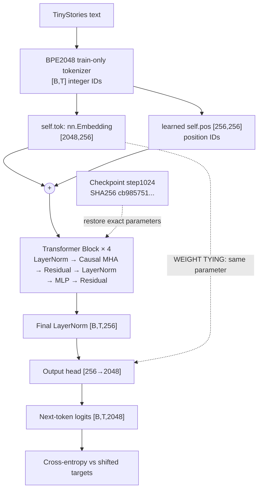
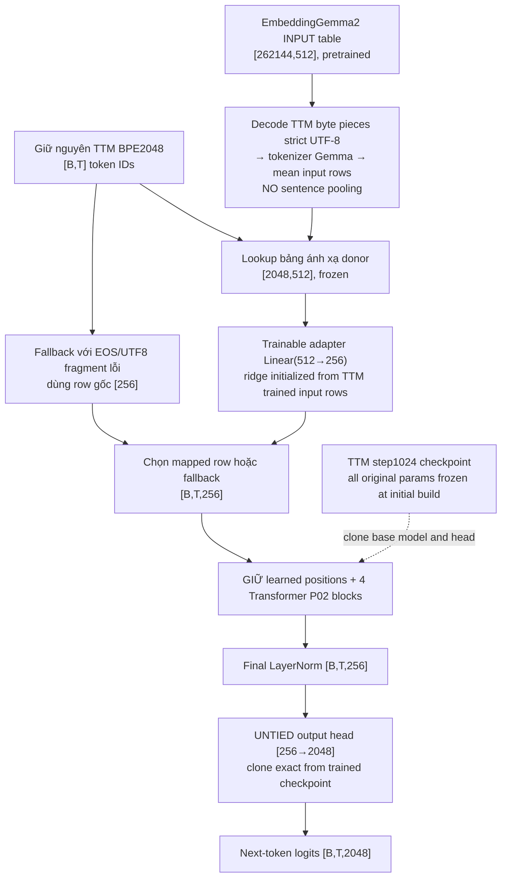

# TTM-Small-4M: diễn giải kiến trúc và thay thế token embedding bằng EmbeddingGemma 2

**Ngày**: 2026-11-09. **Mục tiêu duy nhất:** `TTM_SMALL4M_EMBEDDINGGEMMA2_REAL_TOKEN_MAPPING_AND_CHECKPOINT_INTEGRATION_SINGLE_PASS`. Trạng thái khi viết: `REAL_DONOR_AND_STEP1024_TOGETHER=NOT_EXECUTED`; `CPU_SYNTHETIC_STRUCTURE=PASS_15_OF_15`; `RAG_G4=DEFERRED`.

## 1. Rà soát hai nguồn tham khảo

- [FareedKhan-dev/train-llama4](https://github.com/FareedKhan-dev/train-llama4): giáo trình notebook step-by-step, diễn giải token, embedding, RoPE, RMSNorm, causal attention, router, experts (MoE), loss, training và checkpoint. Ví dụ huấn luyện toy LLaMA-style MoE ~2.24M tham số với character-tokenizer; hữu ích để viết sơ đồ và giảng giải, **không phải implementation có thể chép vào P02 không thay đổi kiến trúc**.
- URL [github.com/Instruction-Tuning-with-GPT-4](https://github.com/Instruction-Tuning-with-GPT-4) là tài khoản/chủ sở hữu; repository tương ứng là [Instruction-Tuning-with-GPT-4/GPT-4-LLM](https://github.com/Instruction-Tuning-with-GPT-4/GPT-4-LLM). Nội dung cung cấp instruction-following data 52K English + 52K Chinese, so sánh câu trả lời, hướng dẫn fine-tuning LLaMA; dữ liệu nghiên cứu CC BY-NC 4.0. Chỉ dành cho giai đoạn instruction-tuning về sau; **không đưa vào nghiên cứu thay token embedding**.

## 2. Dòng dữ liệu mô hình P02 gốc đã huấn luyện

Con số cố định: `vocab=2048`, `context=256`, `hidden=256`, `blocks=4`, `heads=4`, `head_dim=64`, MLP trung gian `1024`, tham số distinct `3,749,376`. P02 dùng **learned position embeddings, LayerNorm, MHA, plain MLP; không có RoPE, MoE, GQA hoặc GPU PagedAttention kernel trong mô hình pilot**. Nguồn gốc `src/p02/transformer_core.py` Git blob `9762343e06cf800b50574c2871ae1ed58537fb18`, SHA256 `e0fcac285918b66b13c8f694e6d625a0691c9b59221b43043e63f46b25ddcc07`.

## 3. Phương án swap đã khóa — thay **đầu vào** duy nhất

Điểm kỹ thuật: Google EmbeddingGemma 2 270M **text encoder** có hidden 512 và token table 262,144; 768 là chiều output sau phép chiếu/mean pooling và **không được thay nhầm thành token input TTM**. Việc dùng raw token lookup là *heuristic transfer*; không sử dụng bidirectional context của Gemma tại bước inference TTM. Nếu token TTM chỉ là byte UTF-8 không hoàn chỉnh hoặc EOS, giữ embedding row gốc thay vì thay thế ký tự giả. Trọng số head phải **untie** để tránh tác động không chủ đích lên đầu ra khi thay `self.tok`. P02 và checkpoint gốc giữ bất biến. Không dùng RAG/BM25/SQuAD.

> **Đây là kiến trúc ứng viên, chưa chứng minh donor cải thiện NLL.** Ridge projection chỉ tối thiểu hóa khoảng cách tới embedding TTM gốc bằng dữ liệu trọng số, không phải bằng chứng ngữ nghĩa.

## 4. Lượt tích hợp trọng số thật duy nhất — không cần GPU

**Notebook được version hóa trên GitHub**: [TTM_Small4M_RealTokenMapping_CPU_OnePass_20261109.ipynb](../../tools/embeddinggemma2_swap/TTM_Small4M_RealTokenMapping_CPU_OnePass_20261109.ipynb). **Mã nguồn ZIP 16,081 bytes do GitHub giữ**: [source_bundle_20261109.zip](../../tools/embeddinggemma2_swap/source_bundle_20261109.zip), Git blob SHA-1 `c48cda36342aff9bcc229010d11e7ce04073d1eb` và bytes SHA256 `bce8ffa8bc954d7f1ba87b08c033e6e8c3dbc925be39cc4b78ef90b6d66a026e`. Notebook tự lấy ZIP chính xác từ commit `efc4eef884dc35fe972ff9124caa20166aefcf7e`; **chủ dự án không cần tự tải ZIP**.

Đầu vào không thay đổi:
- TTM P02 Python SHA256 `e0fcac285918b66b13c8f694e6d625a0691c9b59221b43043e63f46b25ddcc07`.
- TTM TRAIN-only BPE manifest SHA256 `cba18e60cee3d08a353ee6d4a451017289e45af7b4b1179c87171b9b78d7dfdc`, tệp riêng tư có thể cần chọn upload từ Windows `D:\WORK\RESEARCH\TokenToModel-Lab\_tmp\ttm_t1_real_source_v1\T1_BPE2048_REAL_TRAIN_MANIFEST.json` nếu chưa trên Drive. Không tái dựng từ VAL/TEST.
- TTM step1024 `checkpoint.pt` SHA256 `cb985751795c8328ad65acf7ca4c1033ce35182c1bfbdb8c38550de629cb271b`, tệp có trên `MyDrive/ttm-small-pilot/t4_science_4m_1024_a2_20261108_v1/checkpoints/step_1024/checkpoint.pt`.
- Donor `google/embeddinggemma-2@f9972ac22e696a105c482202646979e33e4b5a1e`, safetensors SHA256 `197a32965d4b1105faf060417baa899e193fb73cd401f42ec9295234d5553d79`. Chỉ lấy 4 tệp cần thiết và kiểm SHA. Nếu Colab cache đã mất có thể phải tải lại ~1.1GB. CPU đủ; chọn Colab CPU để không tiêu tốn quota T4.

Kiểm tra trong **cùng một notebook**:
(1) pinned source/manifest/checkpoint/donor hashes; (2) số token mapped/fallback/invalid UTF-8; (3) tạo projection ridge 512→256; (4) kiểm logits finite của donor→TTM; (5) baseline trained = untied-control logits EXACT; (6) nạp lại candidate đã lưu, kiểm logits và future-token isolation; (7) lưu `PROOF_RESULT.json` và `PROOF_READBACK.json` cạnh candidate riêng trong Drive. Không chạy optimizer, không đọc TRAIN/VAL/TEST, không tính khoa học, không đụng GGUF T5 cũ.

**Trạng thái thực:** CPU synthetic QA `15/15 PASS`; khối `real-build` chưa được chạy với nguồn thật trong phiên này. Chỉ sau khi đọc lại hai receipt Drive mới xác nhận `PASS_REAL_INTEGRATION` hoặc ghi lỗi chính xác.

## 5. Cổng khoa học duy nhất về sau

Sau `PASS_REAL_INTEGRATION`, thiết kế một phép so sánh có cùng bộ TRAIN/VAL và cùng số bước tối thiểu giữa (A) baseline tied checkpoint, (B) untied-control, (C) donor-mapped + adapter; thêm đối chứng donor random nếu tài nguyên cho phép. Không dùng sealed TEST để điều chỉnh hyperparameters; **không tự mở science từ PASS kỹ thuật**. Kết quả khoa học, dù PASS hay FAIL, mới được append vào `lineage.md`. Giữ `TTM-Small T5` là ưu tiên chính; `D1_G4_R1_R2_R3=DEFERRED` ở nhánh khác.
