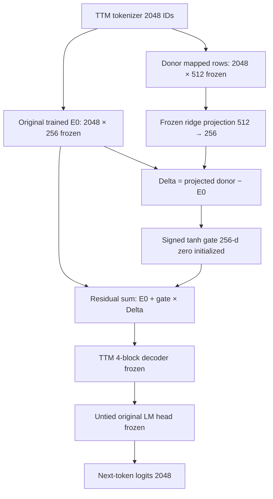

# TTM-Small-4M × EmbeddingGemma 2 — Cơ chế thất bại và một quyết định STOP/GO (DESIGN_ONLY)

**Ngày:** 2026-11-09. **Operation:** `TTM_SMALL4M_EMBEDDINGGEMMA2_MECHANISM_REVIEW_AND_STOP_GO_DESIGN_ONLY`.
**Quyết định duy nhất:** **`STOP_NAIVE_DIRECT_TOKEN_SWAP_AND_GO_ZERO_INIT_RESIDUAL_GATE_DESIGN_ONLY`**.
**Quyền thực nghiệm kế tiếp:** `NOT_AUTHORIZED`. Không huấn luyện, không GPU, không model forward mới, không truy cập TRAIN/VAL/TEST trong rà soát này. Không thay đổi `lineage.md` vì đây là phân tích thiết kế, không phải khoa học mới.

## 1. Bằng chứng gốc khóa và điều đã biết

- **A/B/C/D frozen VAL**: [biên bản frozen-validation một lượt](TTM_SMALL4M_EMBEDDINGGEMMA2_FROZEN_VALIDATION_AB_CPU_ONCE_ADJUDICATION_20261109.md), NLL A/B `3.5223388517`, C `4.3480962661`, D `6.4438256258`; bản QA `PASS_46/46`. Nguồn VAL đã từng dùng cho H1, **không phải blind TEST**.
- **A/B/C/D sau 64 bước**: [phán quyết đã khóa](TTM_SMALL4M_EMBEDDINGGEMMA2_EQUAL64_CPU_ADAPTATION_SCIENCE_ADJUDICATION_20261109.md). Mỗi nhánh 64 optimizer steps × 512 valid TRAIN labels, cùng lịch lấy mẫu, seed, optimizer nhưng **không cùng FLOPs/cấu trúc**; NLL A `3.6203496575`, B `3.6190452345`, C `3.9190499451`, D `4.2870530828`. Bootstrap ghép cặp theo 256 truyện: A−C `−0.2987002876`, CI95% `[−0.3099962949,−0.2886758762]`; B−C `−0.3000047106`, CI `[−0.3115587235,−0.2899196944]`; D−C `+0.3680031377`, CI `[0.3559535590,0.3803695708]`. Kết quả khoa học đã khóa `ADAPTED_TRANSFER_BENEFIT_NOT_ESTABLISHED`; QA `PASS_61/61`. Bằng chứng ở [Drive chủ sở hữu](https://drive.google.com/file/d/1bnrUq2Ty5zhbGvPo0GC94OkEeGf5OZdy/view).
- Dữ liệu nguồn, không được viết đè: [TTM checkpoint step1024](https://drive.google.com/file/d/1F4kaaaC7w3MVPyPFoFa4BpGyWu0LLLme/view), SHA256 `cb985751795c8328ad65acf7ca4c1033ce35182c1bfbdb8c38550de629cb271b`; [candidate swap khởi tạo](https://drive.google.com/file/d/1nuaL5lxkGhGkffJUnTegdS9tKA-H-13A/view), SHA256 `c9fc798d8880c7e76636258052e9885dbb086d7b462a5b6bee5cff8b582973c3`.
- Dùng đúng mã `MappedGemmaInput`, `map_bpe_tokens`, `ridge_align` trong `tools/embeddinggemma2_swap/source_bundle_20261109.zip` SHA256 `bce8ffa8bc954d7f1ba87b08c033e6e8c3dbc925be39cc4b78ef90b6d66a026e`; P02 frozen `src/p02/transformer_core.py` blob `9762343e06cf800b50574c2871ae1ed58537fb18`. Không có MoE/RoPE/GQA trong pilot P02.

## 2. Phân tích ba cơ chế và đối chứng

| Cơ chế | Bằng chứng trực tiếp | Diễn giải được phép | Còn chưa chứng minh |
|---|---|---|---|
| **Tokenizer**: TTM GPT-2-style byte BPE vs donor tokenizer | 1.917/2.048 **loại token** ánh xạ; 130 fragment UTF-8 không hoàn chỉnh và 1 EOS fallback; 50 loại ánh xạ sang nhiều donor IDs bằng phép *mean*; trên VAL cũ 61.108/61.122 token **đầu vào** đã được ánh xạ (99,9771%) | Không thể coi 130 loại chưa map là nguyên nhân *bao phủ* chính của NLL xấu trên tập này; tuy nhiên mean các donor subtoken và token-boundary có thể làm mất tín hiệu | Ánh xạ đúng ngữ nghĩa hay giống input embedding của donor sau contextual encoder; không có kiểm định semantics độc lập |
| **Ridge projection** 512→256 | Trong mã nguồn: bình phương tối thiểu theo **loại token**, không trọng số theo tần suất/VAL, không tối ưu next-token NLL, không có hệ số bias; P = (XᵀX + 0,01I)⁻¹XᵀE_original | Tác động cơ học là thay phần lớn không gian biểu diễn gốc; bảng lookup của donor không tương đương output vector 768-d có ngữ cảnh | Chưa chứng minh ridge là *nguyên nhân nhân quả* chính của NLL tăng |
| **Weight tying / tối ưu** | Trước thích nghi A và B logits **trùng chính xác**. Sau 64 bước A 3,62035 và B 3,61905, chênh ~0,00130; A/B cùng xấu đi ~0,098 trên VAL cũ. C cải thiện 0,429 nhưng vẫn kém B ~0,300 | Việc untie riêng lẻ không giải thích chênh lệch chính; lr chung 1e-4 trên checkpoint đã train có thể làm A/B xấu đi | Không suy ra lịch tối ưu khác sẽ cứu C; không được tự tune theo VAL để biến FAIL thành PASS |

**Bổ sung kiểm tra hình học trên tensor nguồn, chỉ đọc, không chạy model:** từ đúng hai SHA256 của checkpoint/candidate ở trên, lấy `E_old=checkpoint['model']['tok.weight']`, `E_new=source@projection.T`, chỉ thống kê **1.917 ID valid**:
- Cosine theo hàng: trung bình `0.70552033`, median `0.70922828`, p10 `0.57589060`, p90 `0.83054429`.
- Trung bình chuẩn L2 hàng: `E_old=0.57385284`; `E_new=0.42589343`, ~74,2% chuẩn cũ.
- RMS phần dư `sqrt(mean((E_new−E_old)²))=0.02530948`; RMS trọng số cũ `0.03845958`; tỷ số **`0.65808005`**. Trung bình tỷ lệ chuẩn sai số theo token `0.72002763`.
- `candidate['model_state_dict']['tok.fallback']` và embedding gốc trùng chính xác; head candidate ban đầu cũng là bản sao chính xác của head gốc.

**Ý nghĩa:** projection hiện tại chưa bảo toàn hình học đầu vào đã được tối ưu cùng decoder và head. Đây là **nguyên nhân khả dĩ mạnh và giả thuyết cơ chế đáng kiểm định**, không phải minh chứng nhân quả; không sử dụng VAL để tính các thống kê trọng số này.

Lưu ý phân rã khoảng cách: từ frozen đến sau thích nghi, C cải thiện NLL `−0.429046`, A xấu đi `+0.098011`. Khoảng cách C−A hẹp từ `0.825757` xuống `0.298700`, một phần do **mốc đối chứng A suy giảm**, không được gọi toàn bộ là lợi ích học donor.

## 3. Quyết định STOP/GO

**STOP** tiếp tục phương án `self.tok = projection(donor_token_rows)` **thay thế gần như toàn bộ embedding gốc**, vì hai lượt khoa học thực (frozen và adapted64) đều không vượt TTM gốc và phép ridge gây sai khác lớn về hình học. **Không chạy thêm 128/256/1024 bước**, không tự đổi ridge/learning rate rồi chấm VAL lặp để chọn mô hình.

**GO ở mức thiết kế duy nhất** đối với giả thuyết khác thực sự: **giữ chính xác embedding TTM đã học, bổ sung hiệu chỉnh residual có cổng zero-init**, nhằm kiểm định xem donor cung cấp tín hiệu cải thiện *vượt* cấu trúc đã học mà không phá hình học baseline.

Công thức cho token ID `t` hợp lệ, không gồm EOS/fragment lỗi:

```text
E0(t)   = TTM-Small-4M trained embedding [256]
Z(t)    = mapped frozen EmbeddingGemma2 input token row [512]
P       = frozen 512→256 ridge adapter previously pinned
Delta(t)= P @ Z(t) - E0(t)
g       = tanh(a), learnable 256-dimensional signed gate, a initialized to zero
E(t)    = E0(t) + g ⊙ Delta(t)
Fallback t: E(t) = E0(t) exactly
```

- `a=0 → g=0 → E(t)=E0(t)` **chính xác theo phép tính**, nên initial logits của hai nhánh gated phải khớp **B untied**, không thay output head/Transformer. Không dùng sigmoid ở đây vì sigmoid không bằng zero với bias hữu hạn; signed tanh zero-init cho gradient ban đầu khác 0 theo `a`.
- Đề xuất *chỉ* học **256 tham số `a`**; đóng băng `E0`, donor rows, `P`, toàn bộ bốn decoder blocks, learned position và untied output head. Cấu trúc hai nhánh gated có cùng số trainable parameters; không xuất mô hình GGUF khi chưa xác minh exporter có hỗ trợ head untied. Nếu sau này chứng minh có lợi, có thể **fold** `E0 + tanh(a)⊙Delta` thành một bảng `2048×256` để runtime không tải Gemma.
- **B**: trained untied baseline frozen (không optimize). **G_real**: residual gate dùng donor gốc, **G_perm**: residual gate dùng donor permuted seed 20261109, cùng valid mask, cùng ridge refit và gate zero-init. At step0, cả ba logits phải bằng nhau. Cấu hình này sửa đúng cơ chế phá hình học đầu vào, kiểm tra liệu hiệu chỉnh donor có giá trị thêm hay không; không mặc định PASS.



## 4. Đề xuất duy nhất cho một phép thử có thể bác bỏ — CHƯA ĐƯỢC PHÉP CHẠY

**Candidate protocol (not an executable scientific authorization):** `TTM_SMALL4M_EMBEDDINGGEMMA2_ZERO_GATE_RESIDUAL_32_STEP_CPU_PROBE`.

- CPU-only, no GPU; same original frozen TRAIN/VAL pack, never TEST. Exactly **32 AdamW steps × 512 TRAIN target labels** for **G_real và G_perm**, shared precomputed sampling schedule, same seed, optimizer, and gradient clipping; chỉ 256 gate parameters mỗi arm cập nhật. B baseline frozen, không cập nhật. No fresh 1,024-step P02 run.
- Một quyết định + một lượt RUN_ID: kiểm `step0` logits B = G_real = G_perm (zero gate) rồi train cùng budget và chấm VAL **một lần sau 32 bước**. No checkpoint selection, no tuning, no repeated VALIDATION sweeps. Cho QA đọc lại private per-story sums và bản checkpoint nhỏ.
- Thước đo cần cố định *trước khi thực nghiệm*: token-weighted VAL NLL và paired story-bootstrap (256 stories, 1,000 bootstrap draws, seed 20261109) của **B−G_real** và **G_perm−G_real**. “Tín hiệu dương trên pilot” chỉ khi **cận dưới CI95% của cả hai chênh lệch >0**, no integrity faults. Không đạt → `STOP_GATED_PROBE_SCOPED`, **không tự động tăng bước**.
- Dù kết quả đạt, vì VALIDATION đã được xem nhiều lần và mới một seed, chỉ gọi **exploratory signal**, không được tuyên bố lợi ích chuyển giao tổng quát hay ứng dụng được; trước sản phẩm thực tế cần bộ dữ liệu độc lập hợp lệ/thiết kế confirmatory mới.
- Kế hoạch optimizer chi tiết (LR constant, weight decay, runtime) phải được ghim trước CLAIM ở một *hợp đồng duy nhất* khi chủ dự án phê duyệt, không mở micro-permits và không đọc VAL để chọn LR.

## 5. Biên giới và trạng thái cuối

- **Hiện tại:** `DIRECT_SWAP=STOP` · `ZERO_GATE_RESIDUAL=GO_DESIGN_ONLY` · `NEW_SCIENCE=NOT_AUTHORIZED` · `GPU_USED=0` · `TRAIN_EXECUTED_IN_THIS_REVIEW=0`.
- Preserved `ADAPT64=COMPLETED_ONCE` / QA `PASS_61/61` / original checkpoint / four adapted checkpoints / `TEST=SEALED`.
- `D1_G4_R1_R2_R3=DEFERRED`. TTM-Small T5 remains first execution priority.
- **No `lineage.md` append**: the negative scientific result is already L0014; this is a retrospective mechanism review and new research DESIGN, not a new experiment.
- No merge, branch cleanup, local Windows modifications, PR #12 edits, or production deployment.
