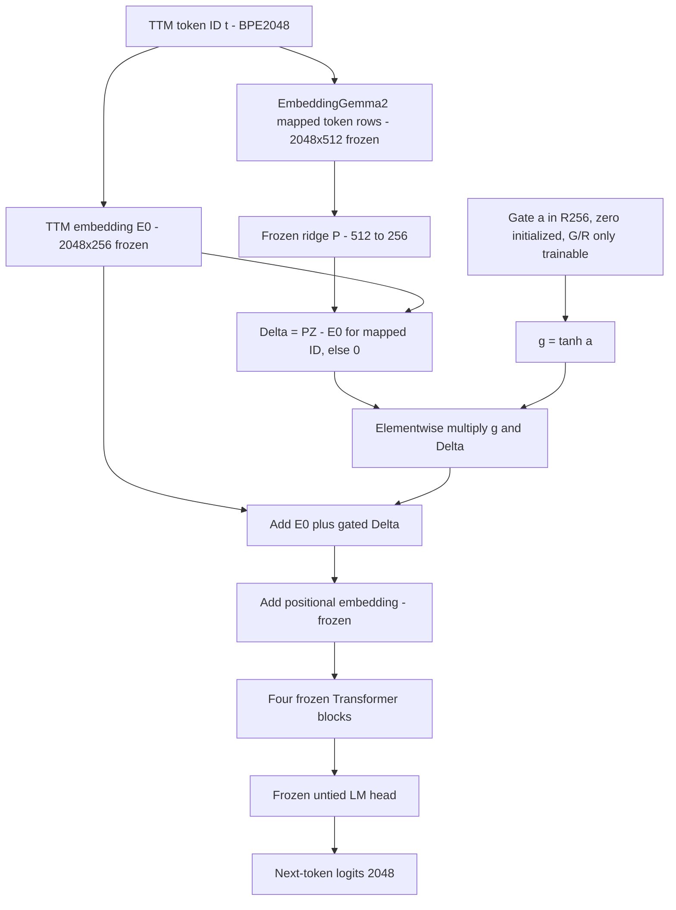

# TTM-Small-4M × EmbeddingGemma 2 — B/G/R chính xác, so sánh với TTM gốc, thiết kế đối chứng nhân quả sau L0018

**Ngày:** 2026-11-09. **Trạng thái:** `DESIGN_ONLY`, không huấn luyện, không chấm TEST/holdout, không tạo CLAIM hay checkpoint, không mở GGUF/Ollama.  
**Operation:** `TTM_SMALL4M_EMBEDDINGGEMMA2_MECHANISTIC_CAUSAL_DIAGNOSTIC_DESIGN_ONLY`.  
**Nhánh:** `research/ttm-small4m-embeddinggemma2-token-swap-minimal-proof-20261109`.  
**Lịch sử đóng băng:** L0014 âm ở 64 bước, L0015 chưa xác nhận ở 1.024, L0016 thăm dò dương ở 2.048, L0017 PASS fixed-checkpoint holdout 320, L0018 GATED32 thất bại tiêu chí donor-specific. Không sửa `lineage.md`.

## A. Mô hình B/G/R đã chạy thật ở L0018

Đầu vào TTM **byte-BPE 2.048 ID**, n_embd=256, context=256, **4 decoder Transformer blocks, 4 attention heads**, LayerNorm, learned position embedding; logits 2.048 từ **untied** LM head ở cả B/G/R. Nạp từ checkpoint T4 TTM bước 1.024 SHA256 `cb985751795c8328ad65acf7ca4c1033ce35182c1bfbdb8c38550de629cb271b`.

- **B**: không có gate, `E(t)=E0(t)`; toàn bộ frozen và không optimizer, 0 trainable.
- **G**: donor mapped đúng 1.917 loại token, `E(t)=E0(t)+tanh(a_G)⊙(P_real Z_real(t)-E0(t))`; 256 tham số cổng, các trọng số khác frozen.
- **R**: hoán vị donor rows trên 1.917 mapped IDs seed 20261109, **refit ridge** trên mapping đã hoán vị, rồi dùng `tanh(a_R)`; cũng 256 tham số cổng. Cho EOS/token không map, hiệu chỉnh bằng 0, giữ nguyên E0.
- Step0 `a=0`, logits B=G=R **bằng nhau chính xác**, xác nhận trong CLAIM. Sau đó đúng **32 bước AdamW × 512 nhãn TRAIN/nhánh**, LR `3e-3`, chỉ cập nhật a ở G/R, B không huấn luyện. VALIDATION đã dùng nhiều lần: 256 truyện/328 cửa sổ/61.122 nhãn. Không gọi contextual encoder Gemma khi forward.

## B. Kết quả đã có, tránh xếp hạng sai giữa các phép thử

| Lượt | Cấu hình | NLL (nats/token) | Kết luận |
|---|---|---:|---|
| L0018 256 VALIDATION cũ, TTM1024 | B frozen untied | 3.5223388275 | Baseline; logits ban đầu bằng TTM tied |
| L0018 cùng tập/cùng checkpoint đầu | G gate real | 3.5213177127 | B−G +0.0010211148, CI95 [0.0007229702,0.0012893495] |
| L0018 cùng tập/cùng checkpoint đầu | R gate permuted | **3.5205936608** | R−G −0.0007240519, CI95 [−0.0010824418,−0.0003801699] |
| L0017 320 holdout mới, 2048 train steps | A tied | 3.3414141970 | Đối chứng trong L0017 |
| L0017 cùng 320 holdout | B untied | 3.3581664488 | Đối chứng trong L0017 |
| L0017 cùng 320 holdout | C donor direct-swap + trained projection/decoder | **3.3086025043** | PASS cả A−C, B−C, D−C |
| L0017 cùng 320 holdout | D permuted direct-swap + trained projection/decoder | 3.4265771699 | Đối chứng trong L0017 |

**Không so trực tiếp NLL L0018 với L0017:** khác VALIDATION/holdout, checkpoint và mức độ huấn luyện. L0018 chỉ cho thấy G cải thiện rất nhỏ so với baseline B nhưng **không tốt hơn R**. C2048 đã chứng minh lợi ích dự đoán *cho checkpoint cố định*, chưa xác định nguyên nhân riêng của donor. Quyết định STOP sau 64 bước không còn áp dụng tổng quát cho direct-swap; lịch sử L0014 vẫn nguyên.

## C. Câu hỏi nhân quả và lỗ hổng nhận dạng

Cần phân biệt ba nguồn khả dĩ của lợi thế C2048:
1. **Gán token chính xác (donor identity alignment):** vector donor thật có gắn đúng BPE token có ích hơn dữ liệu donor hoán vị không?
2. **Phép chiếu (projection geometry):** tín hiệu có phụ thuộc ridge 512→256 thay vì một phép chiếu cùng kích thước khác hay không?
3. **Thích nghi Transformer:** năng lực bộ giải mã học lại sau direct-swap đóng góp bao nhiêu; chỉ học projection có đủ không?

L0018 **không** trả lời câu hỏi 1 cho C2048: nó dùng gate, đóng băng decoder, chỉ 32 bước và donor hoán vị được **refit ridge**. Ngay cả với 256 tham số ngang nhau, `mean(||Delta||)` là 0.39382985 ở G và 0.45858899 ở R. Đó là một nhiễu hình học. L0017 C/D cùng dạng trainable nhưng D cũng refit ridge, nên không tự động cô lập donor semantics khỏi hình học phép chiếu.

## D. Thiết kế đề xuất: một ma trận 6 nhánh phân biệt được ba giả thuyết

**Không phải quyền thực thi.** Đây là thiết kế tối thiểu có chủ đích, chưa niêm phong lịch đào tạo / holdout / ngân sách; không tạo thêm quá trình chuẩn bị vi mô. Khi owner quyết định mở thực nghiệm, đóng **một hợp đồng tích hợp** duy nhất trước CLAIM.

Khởi tạo **cùng một checkpoint TTM T4 bước 1.024**; đầu ra untied; cùng valid mask 1.917/2.048, fallback giữ E0. Không dùng checkpoint C/D đã huấn luyện để khởi tạo các nhánh cơ chế.

Ba trục can thiệp:
- **Gán token:** donor thật vs **permutation sau khi đã fit một projector chung**; mỗi cặp dùng **một cùng matrix P ban đầu**, không refit projection chỉ cho control. Các vector `PZ` của hai nhánh là cùng một multiset, nên mean/covariance/eigen-spectrum và histogram row norms **đồng nhất theo toàn tập token map tại bước 0**. Không hứa khoảng cách `PZ(t)-E0(t)` theo từng token là như nhau.
- **Phép chiếu:** (i) ridge fit theo đúng công thức `lambda=.01`, (ii) phép chiếu chữ nhật Procrustes trực giao 512→256 (từ cùng 1.917 cặp vector), sau đó scale được định nghĩa từ E0/map types trước khi train; không dùng VALIDATION để fit. Cả hai đều tạo ma trận 256×512 và có cùng trainable count khi optimizer mở.
- **Thích nghi:** (i) **adapter-only**: chỉ matrix P được huấn luyện, toàn bộ TTM decoder/head/position frozen; (ii) **full-adaptation**: P và decoder/head/position được huấn luyện từ cùng clone. Trong từng cặp real/perm, trainable count và FLOPs tương đương; **không** giả vờ adapter-only và full-adaptation có bằng FLOPs hoặc số tham số.

| Arm | Token donor | Projector khởi tạo | Cập nhật sau khởi tạo | Vai trò |
|---|---|---|---|---|
| **RR-F** | Real đúng mapping | Ridge | P + TTM decoder, position, head | C-like chủ đạo; phải kiểm source parity với recipe C |
| **RP-F** | Permuted **sau ridge chung** | **Cùng P ridge với RR-F** | P + TTM decoder, position, head | Khử tương quan gán token, giữ projected vector multiset |
| **RR-A** | Real đúng mapping | Ridge | Chỉ P (adapter-only) | Kiểm hiệu ứng thiếu thích nghi decoder |
| **RP-A** | Permuted sau ridge chung | **Cùng P ridge với RR-A** | Chỉ P (adapter-only) | Đối chứng năng lực tối ưu ngang RR-A |
| **OR-F** | Real đúng mapping | Orthogonal/Procrustes | P + TTM decoder, position, head | Đối chứng projector init |
| **OP-F** | Permuted sau orthogonal chung | **Cùng P với OR-F** | P + TTM decoder, position, head | Đối chứng mapping cho phương pháp chiếu thứ hai |

Không chạy lại R-gate của L0018; không dùng lại D kiểu **permute-rồi-refit-ridge** làm đối chứng gốc của phép thử mới. D cũ vẫn là bằng chứng lịch sử và mốc giải thích vì sao cần cặp RP-F tốt hơn về geometry. Baseline B/A cũ chỉ làm mốc mô tả; nếu muốn kết luận tuyệt đối *mới* về lợi ích so với baseline trong cùng lượt, cần thêm nhánh baseline train-matched B vào hợp đồng **trước CLAIM**, không được bổ sung sau khi thấy số liệu.

### Các đối chứng và suy luận cho phép

Gọi `L(arm)` là NLL cùng một nguồn đánh giá, cùng split, cùng số nhãn. Số dương khi nhánh real tốt hơn permuted:

- **Donor assignment under ridge+full:** `tau_D = L(RP-F) − L(RR-F)` — đối chứng chính về gán token ở điều kiện sát C2048 nhất.
- **Tác dụng thích nghi decoder lên chênh lệch mapping:** `tau_A = [L(RP-F)−L(RR-F)] − [L(RP-A)−L(RR-A)]` — hiệu ứng tương tác do mở decoder, **không** đồng nghĩa cùng FLOPs giữa hai chế độ.
- **Tác dụng lựa chọn phép chiếu lên chênh lệch mapping:** `tau_P = [L(RP-F)−L(RR-F)] − [L(OP-F)−L(OR-F)]` — phép thử tương tác với projector, **không** chứng minh ridge tốt hơn về NLL tuyệt đối chỉ từ một tương tác.

Ma trận 6 nhánh không đo tương tác bậc ba `projection × adaptation × donor`; không suy diễn ngoài những ô được chạy. Đặc biệt, projector ridge fit trên correspondence thật và được chia sẻ với control đã mang dấu ấn correspondence; kết quả `tau_D` **không tách được** mọi thông tin mapping khỏi lựa chọn projection. Mục tiêu là kiểm soát geometry tốt hơn so với refit của R/D, không tuyên bố causal identification tuyệt đối.

### Khóa ngân sách, dữ liệu và phân xử (đề xuất trước thực thi)

1. **Ngân sách cùng TRAIN** cho cả sáu arms; source runner C2048 lịch sử thực hiện 2.048 optimizer steps × 4.096 targets mỗi arm, AdamW LR 1e-4, betas(.9,.95), eps1e-8, weight_decay .1 và clip1. Để suy luận về *lợi thế sau 2.048 bước*, so sánh chính phải giữ cùng quy mô cập nhật; nếu không đủ tài nguyên, có thể chọn một pilot nhỏ *trước khi chạy*, nhưng kết luận chỉ là exploratory cơ chế ngắn hạn, **không giải thích trực tiếp C2048**. Ngân sách, hardware, schedule và max wall-clock cần owner duyệt ở hợp đồng duy nhất; không tự khởi động GPU. 6 arms ở ngân sách lịch sử sẽ yêu cầu 50.331.648 token-label exposures, chưa tính forward/eval. Đó là chi phí đáng cân nhắc, không được gọi là một phép chạy CPU nhanh.
2. **Nguồn TRAIN/VALIDATION:** dùng đúng T4 TRAIN/VAL pack SHA256 `184f68b4c0c800ef3e98362c2e20e1cd35baa269e926489a475664526ecd9913` (source checkpoint SHA256 `cb985751795c8328ad65acf7ca4c1033ce35182c1bfbdb8c38550de629cb271b`), không dùng TEST cũ, không đọc/lặp lại **320 truyện L0017**. VALIDATION T1 (256 truyện) đã dùng nhiều lần: chỉ đánh giá exploratory, không được gọi là blind confirmation.
3. **Nếu sau này muốn confirmatory:** lựa chọn, chống trùng, khóa một *holdout mới riêng biệt* trước model forward, không dùng lại 320 hoặc lịch sử TEST. Không bắt buộc có chứng cứ từ trước cho một tập mới chưa được chọn; chỉ cần audit khả thi trước chấm.
4. **Công bằng:** khóa random seeds (nhiều seed huấn luyện nếu ngân sách cho phép), schedule TRAIN, số nhãn, optimizer, initialization, P trainable mask; kiểm equality của *projected-row multiset* giữa real/perm trước train; khóa phép chuẩn hóa, đo row norms/covariance và perturbation RMS trên **token tables**, không dựa VAL; báo cáo trainable params/FLOPs theo arm. Cùng projector-init trong mỗi cặp real/perm; hai phương pháp projection định nghĩa trước. Không được dùng seed tốt nhất/chỉnh projector theo VAL.
5. **Phân tích:** metric NLL token-weighted; bootstrap ghép cặp theo truyện trên split được chọn hợp lệ; báo cáo `tau_D` là chính, `tau_A,\tau_P` thăm dò; chọn quy tắc nhiều kiểm định/multiple comparisons **trước** mở kết quả. Nếu chỉ 1 seed và VALIDATION reuse, tất cả kết luận vẫn **exploratory**, bất kể CI >0.
6. **One-shot:** mã, checkpoint, mask, projection, resource, schedule, dataset, CLAIM, independent QA và STOP/PASS/FAIL trong một hợp đồng tích hợp. Không tạo micro-permits. Nếu claim bị gián đoạn phải giữ evidence, không phát lại. Không tự tăng bước hoặc thêm arm sau khi nhìn điểm.
7. **Rủi ro khoa học tồn dư:** donor pretrained data provenance không rõ; shared projection fitted to real token mapping; parameter count và FLOPs khác giữa frozen/full adaptation; batch/seed variance; nhánh full có các yếu tố tối ưu khác projector-only. Không tự khẳng định “ngữ nghĩa donor gây nên mọi cải thiện”.

## E. Kết luận và cổng hiện tại

- `DIRECT_SWAP_C2048=L0017_FIXED_CHECKPOINT_PASS_PRESERVED`.
- `GATED32=L0018_COMPLETED_ONCE;GATED_DONOR_SPECIFIC_SIGNAL_NOT_ESTABLISHED`.
- `MECHANISM_CAUSAL_DIAGNOSTIC=DESIGN_ONLY`; 6-arm proposal **NOT_EXECUTED**, **NOT_PREREGISTERED_FOR_EXECUTION**, chưa cấp phép GPU/CPU training.
- `GGUF_APPLICATION_BACKLOG=DEFERRED`. Không sửa main, `lineage.md`, A/B/C/D hoặc G/R checkpoint.
- **Bước thực hiện tiếp theo**: owner xem xét ma trận 6 arms và ngân sách; sau đó chỉ khi được chấp thuận mới chuẩn bị *một* hợp đồng source + seeds + data/evaluator + resource hoàn chỉnh và thực thi one-shot. Nếu ngân sách lịch sử quá lớn, không được gán nhãn một pilot rẻ hơn là “giải thích C2048”.

**Nguồn thực chứng:** `lineage.md` mục L0017 và L0018; báo cáo `TTM_SMALL4M_GEMMA2_CONFIRMATORY_320_CPU_ONE_SHOT_INDEPENDENT_SCIENCE_ADJUDICATION_20261109.md`; `TTM_GEMMA2_GATE32_CPU_ONE_SHOT_INDEPENDENT_SCIENCE_ADJUDICATION_20261109.md`; mã gốc `ttm_embeddinggemma2_swap.py` SHA `d11da61e9d7bb040f3263e680f026817a513553c186ab243e184ffaf6e68cd39`, `ttm_directswap2048_gpu_once.py` SHA `0994f0cd91cb504f2db8478f55963813a85469807f2921e38c196248f323759e`, `ttm_gemma2_gate32_cpu_once.py` SHA `235816631eedbe212f7f431700024f1e4ae8e470fd5b0cabcdabd78421c815bf`.
